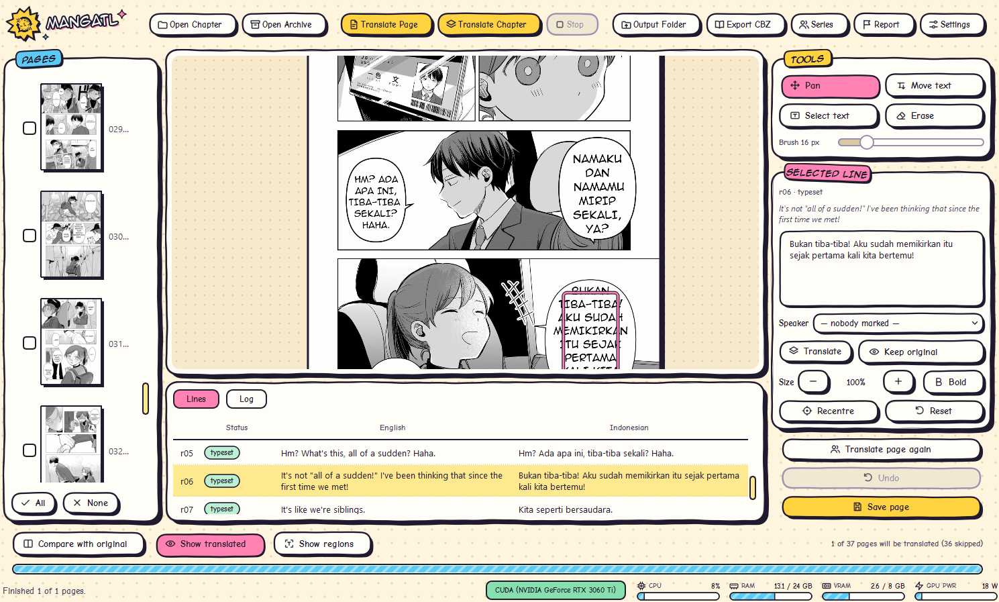

<p align="center">
  
</p>

<h1 align="center">MangaTL</h1>

<p align="center">
  <b>Automatic manga translation for Windows: it reads the balloons, erases the lettering, translates it and letters it back in, the way a scanlation team would.</b><br>
  Pick a chapter folder, press one button, and get pages whose balloons hold the translation set in a comic font, not subtitles pasted over the artwork.
</p>

<p align="center">
  <a href="https://github.com/Kanee18/Manga-tl/releases/latest"></a>
  
  
  
</p>

<p align="center">
  
</p>

---

## Contents

- [What is MangaTL](#what-is-mangatl)
- [Features](#features)
- [System requirements](#system-requirements)
- [Download and install](#download-and-install)
- [Choose a translator: offline or online](#choose-a-translator-offline-or-online)
- [How to use it](#how-to-use-it)
- [Privacy](#privacy)
- [Troubleshooting](#troubleshooting)
- [Updating and uninstalling](#updating-and-uninstalling)
- [Reporting a bug](#reporting-a-bug)
- [License](#license)
- [Credits](#credits)

---

## What is MangaTL

MangaTL does every step a scanlation team usually does, right on your own computer:

1. **Finds** every balloon and piece of lettering on the page.
2. **Reads** it (OCR), vertical lettering included.
3. **Translates** a whole page at once, so the conversation between balloons stays coherent.
4. **Erases** the original. Plain balloons are filled with their own colour; lettering over artwork is rebuilt with AI inpainting.
5. **Letters the translation back in** with a comic font, fitted to the shape and size of each balloon.

<p align="center">
  <br>
  <sub>Left: the original page. Right: MangaTL's output (English → Indonesian), with no manual editing.</sub>
</p>

---

## Features

- **One click per chapter.** Open a folder of images or an archive (`.cbz`, `.cbr`, `.zip`, `.rar`, `.7z`), tick the pages to translate, and run.
- **Fully offline** with a local AI model through [Ollama](https://ollama.com), or **online** through an API: OpenAI, Anthropic Claude, Google Gemini, OpenRouter, Groq, DeepSeek, Mistral, or any other OpenAI-compatible server.
- **Sound effects and lettering drawn into the art are left alone**, and so are page numbers and anything else that needs no translation.
- **Edit right in the app.** Change the translation, size, position or weight of any balloon, brush away leftovers, and compare with the original. Undo is always there.
- **Series sheet**: note character names, terms and each character's way of speaking, so the translation stays consistent from chapter to chapter.
- **Glossary**: terms that must always be translated one particular way.
- **Pick up where you left off**: translated pages are kept, so you can come back and correct them later.
- **Export to CBZ** for your comic reader.
- **Interactive tour** on first launch. Press **F1** any time to see it again.
- **Report button** that saves everything needed to report a wrong translation.

### Supported languages

| From \ To | Indonesian | English |
|---|:---:|:---:|
| **English** | ✅ (most tuned) | — |
| **Japanese** | ✅ | ✅ |
| **Chinese** | ✅ | ✅ |

---

## System requirements

| | Minimum | Recommended |
|---|---|---|
| **Operating system** | Windows 10 64-bit | Windows 11 64-bit |
| **Processor** | 64-bit (x64) | A modern 64-bit processor |
| **RAM** | 8 GB | 16 GB or more |
| **Graphics card** | Not required; runs on the CPU | NVIDIA with **8 GB of VRAM** (GTX 16 series / RTX or newer) |
| **Disk space** | ~3 GB (online translator) | ~11 GB (offline translator) |
| **Internet** | Only to download | Only when using an online translator |

**Disk space in detail:** the installer is ~1.3 GB and unpacks to ~2.8 GB. Offline mode needs another ~7.2 GB for the `gemma4:e2b` language model.

**Speed** (measured on an RTX 3060 Ti 8 GB, 24 GB RAM, `gemma4:e2b`):

| | |
|---|---|
| First page each time the app starts | ~2 minutes (loading every model) |
| Every page after that | **~30 seconds** a page |
| A 32-page chapter | ~20 minutes, unattended |
| VRAM used | ~3 GB |

Without an NVIDIA card the app still works, but a page can take several minutes.

---

## Download and install

1. Go to the **[Releases](https://github.com/Kanee18/Manga-tl/releases/latest)** page.
2. Download **`MangaTL-Setup-1.0.0.exe`** (~1.3 GB).
3. Run it.
   > If a blue **"Windows protected your PC"** screen appears, click **More info → Run anyway**. It appears because the installer is not signed with a paid code-signing certificate, not because anything is wrong with it.
4. Follow the wizard. No administrator rights are needed; the app is installed in `%LOCALAPPDATA%\Programs\MangaTL`.
5. Leave **Create a desktop shortcut** ticked if you want an icon on the desktop.
6. Done. MangaTL is in the **Start menu** and on the desktop.

Then choose a translator (below).

---

## Choose a translator: offline or online

MangaTL does the finding, reading, erasing and lettering itself. The **translating** is done by a language model (AI), and you can choose either of two ways to have one.

### A. Offline with Ollama (free and private)

For computers with an NVIDIA graphics card, when nothing should leave your machine.

1. Install **[Ollama](https://ollama.com/download)** (version 0.20 or newer).
2. Open **Command Prompt** and run this (a ~7.2 GB download, once):
   ```
   ollama pull gemma4:e2b
   ```
3. Start MangaTL. Ollama with `gemma4:e2b` is the default translator, so it is ready to go.

### B. Online through an API (no powerful graphics card needed)

For laptops and computers without an NVIDIA GPU. The results are usually better too, but **API services charge for what you use** (some have a free tier).

1. Open **Settings** in MangaTL.
2. Under **Translator**, pick a service, such as **Google Gemini**, **OpenAI** or **Anthropic Claude**.
3. Click the **Get a key from …** link under the API key field, create a key on that service's site, and paste it into **API key**.
4. Press **Refresh** to list the models, pick one, and click **OK**.

Each service remembers its own key and model, so you can switch between them any time.

---

## How to use it

1. **Put a chapter in one folder** of page images (`001.jpg`, `002.jpg`, …), or use a single `.cbz` / `.zip` / `.rar` / `.7z` archive.
2. Click **Open Chapter** (`Ctrl+O`) or **Open Archive**. You can also drag the folder onto the window.
3. **Untick the pages** that need no translation: covers, credit pages, pages that are all artwork.
4. Try one page first with **Translate Page** (`Ctrl+T`).
5. Check the result. **Compare with original** shows the page before and after; the **Lines** tab lists the original text and its translation.
6. Happy with it? Click **Translate Chapter** (`Ctrl+Shift+T`).
7. A balloon not quite right? Click it, change its text or size in the right-hand panel, and press **Save page**.

The results are saved next to your chapter, in a folder ending in **`_ID`**. Click **Export CBZ** to turn them into a single comic file.

> **Tip:** set the **Reading order** in Settings before translating a chapter. Unflipped manga reads `rtl` (right to left, the default); western comics and flipped releases read `ltr`. With the wrong order, the context of the conversation gets mixed up.

---

## Privacy

- **Offline mode (Ollama):** no image, text or data of any kind is sent over the internet. Everything is processed on your computer.
- **Online mode (API):** **only the text inside the balloons** is sent (along with your series notes and glossary). **Page images are never sent.** That text is processed by the service you chose, under its own privacy policy.
- **API keys** are stored on your own computer (`%LOCALAPPDATA%\MangaTL\api_keys.json`) and are never included in a bug report.
- MangaTL needs no account, and has no ads and no tracking.

---

## Troubleshooting

| Problem | Solution |
|---|---|
| **"Windows protected your PC"** when installing | Click **More info → Run anyway**. |
| The app does not open | Open `%LOCALAPPDATA%\MangaTL\startup-error.log` (paste that path into Explorer) and include its contents when you report it. |
| **translator: NOT READY** | **Offline:** Ollama is not running or the model is not downloaded. Run `ollama pull gemma4:e2b`, or start the Ollama app. **Online:** check your API key and internet connection. |
| A page takes several minutes | The model does not fit in VRAM. Run `ollama ps` in Command Prompt: the PROCESSOR column should say `100% GPU`. Close other apps using the GPU, or use an online translator. |
| Not sure what is wrong | Run the **self-test**: open Command Prompt and run `"%LOCALAPPDATA%\Programs\MangaTL\MangaTL.exe" --selftest`. It checks the six things that must work and marks any that fail. |
| A balloon is still in the original language | Check its status in the **Lines** tab. `skipped_sfx` is a sound effect left alone on purpose. `failed_fit` means the translation did not fit; type a shorter one in the right-hand panel. |
| A character's name changes from page to page | Add the name to the **Series** sheet or the **Glossary**. |

---

## Updating and uninstalling

- **Update:** download the new installer and run it. It replaces the old version in place.
- **Uninstall:** open **Windows Settings → Apps → MangaTL → Uninstall**.
- Your settings, API keys, series notes and projects are **kept** when you uninstall or update. They live in `%LOCALAPPDATA%\MangaTL`; delete that folder for a completely clean slate.

---

## Reporting a bug

1. When a translation comes out wrong, select the balloon, click **Report** in the app, and describe what is wrong.
2. The app saves the report in `%LOCALAPPDATA%\MangaTL\reports\`.
3. Open a report on the **[Issues](https://github.com/Kanee18/Manga-tl/issues)** page and attach that report folder (zipped) with a short description.

---

## License

MangaTL is **freeware**: free to use, but **not open source**. Its source code is not published.

- ✅ Free to use for personal purposes.
- ❌ Not to be sold, modified, reverse engineered or redistributed without permission. Share a link to this page, not the installer itself.

The full terms are in [LICENSE](LICENSE).

**About content:** MangaTL only translates files you already have. It does not download comics from anywhere. Whether you have the right to translate and share a given comic is up to you.

---

## Credits

MangaTL is made by **[Kanee18](https://github.com/Kanee18)**, on top of great work by many others:

| Part | Work |
|---|---|
| Text and balloon detection | [ogkalu/comic-text-and-bubble-detector](https://huggingface.co/ogkalu/comic-text-and-bubble-detector) |
| Glyph mask and text lines | [dmMaze/comic-text-detector](https://github.com/dmMaze/comic-text-detector) |
| OCR (comic lettering reader) | [genshiai-daichi/baberu-ocr](https://huggingface.co/genshiai-daichi/baberu-ocr) |
| Text removal (inpainting) | [LaMa](https://github.com/advimman/lama), via [mayocream/lama-manga-onnx](https://huggingface.co/mayocream/lama-manga-onnx) and [Carve/LaMa-ONNX](https://huggingface.co/Carve/LaMa-ONNX) |
| Offline translation model | Gemma (`gemma4:e2b`) by Google, run through [Ollama](https://ollama.com) |
| Fonts | Anime Ace 2 by [Blambot](https://blambot.com), [Comic Neue](https://comicneue.com) |
| Interface | [Qt](https://www.qt.io) and [PyQt6](https://www.riverbankcomputing.com/software/pyqt/) |
| AI and imaging | [ONNX Runtime](https://onnxruntime.ai), [OpenCV](https://opencv.org), [Skia](https://skia.org) via skia-python, [NumPy](https://numpy.org) |
| GPU | NVIDIA CUDA and cuDNN |
| Installer | [Inno Setup](https://jrsoftware.org/isinfo.php) |

The full list, with each one's license, is in [THIRD-PARTY-NOTICES.md](THIRD-PARTY-NOTICES.md).

Thank you to everyone who made the models and libraries above. Without their work, MangaTL would not exist. 🙏
