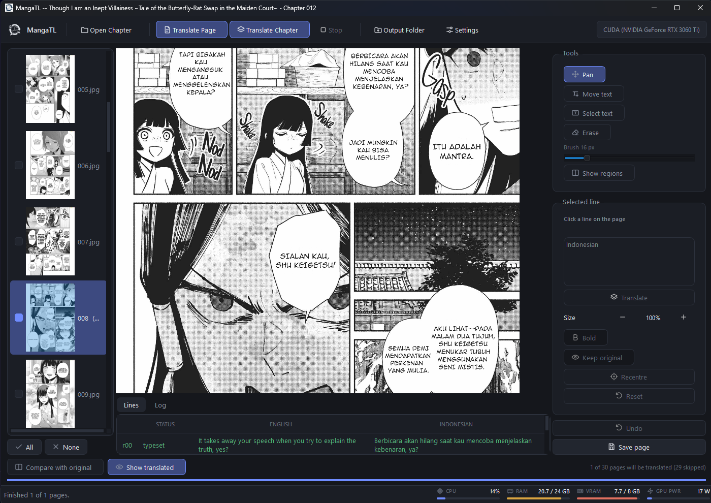
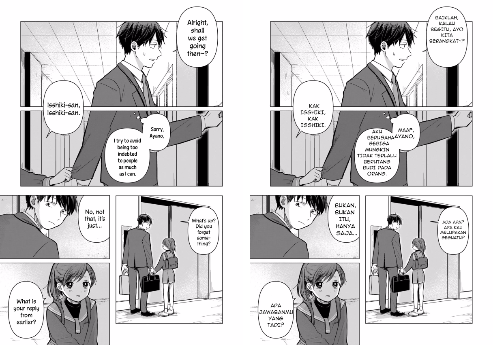

<p align="center">
  
</p>

<h1 align="center">MangaTL</h1>

<p align="center">
  <b>Offline manga translation with typeset-quality lettering.</b><br>
  Point it at a chapter folder and get back pages whose balloons hold real
  lettering set in a comic face — not subtitles pasted over the artwork.
</p>

<p align="center">
  
  
  
</p>

<!-- Preview image: the main window with a translated page open.
     Drop the file at docs/images/app.png (or change the path). -->
<p align="center">
  
</p>

---

## Contents

- [What it does](#what-it-does)
- [Languages](#languages)
- [Requirements](#requirements)
- [Installation](#installation)
- [First run](#first-run)
- [Using it](#using-it)
- [Settings](#settings)
- [How a page is translated](#how-a-page-is-translated)
- [What to expect](#what-to-expect)
- [Troubleshooting](#troubleshooting)
- [Design notes](#design-notes)
- [Development](#development)
- [Credits and licences](#credits-and-licences)

---

## What it does

Everything runs on your own machine. No page, no line of text and no image
ever leaves it — there is no account, no API key and no network call except to
Ollama on `localhost`.

- **Finds the lettering and the balloons it sits in**, with a detector trained
  on manga, webtoons, manhua and western comics.
- **Reads it** with a recogniser trained on comic balloons, in English,
  Japanese or Chinese, vertical lettering included.
- **Translates a whole page in one request**, in reading order, so the model
  sees the balloons as one conversation rather than as isolated fragments.
- **Erases the original** — flat fill where the ground is uniform, LaMa
  inpainting where there is artwork behind the words.
- **Sets the translation back into the balloon**, measured line by line
  against the shape it has to fit, at a size taken from the lettering it
  replaces.
- **Leaves alone what should be left alone**: hand-drawn sound effects, signs
  and props, and anything whose translation is its own source.
- **Lets you fix the rest by hand**, in the window, with the page in front of
  you and undo behind you.

<!-- Preview image: a page before and after translation, side by side.
     Drop the file at docs/images/before-after.png -->
<p align="center">
  
</p>

---

## Languages

Set the pair in **Settings → Translate**. The recogniser reads all three source
scripts, vertical lettering included.

| | to Indonesian | to English |
|---|---|---|
| **English** | ✅ the original pair, and the one with the most tuning behind it | — |
| **Japanese** | ✅ | ✅ |
| **Chinese** | ✅ | ✅ |

A pair is more than two names in a prompt: it decides how the source reading is
repaired, how recognised lines are joined back together, what counts as a line
that came back untranslated, and how the target should read. See
[Design notes](#design-notes) for what changes and why.

---

## Requirements

### Minimum and recommended

| | Minimum | Recommended |
|---|---|---|
| **OS** | Windows, Linux or macOS | Windows 10/11 |
| **Python** | 3.11 | 3.11 |
| **RAM** | 8 GB | 16 GB |
| **GPU** | none — the CPU path works | NVIDIA with **8 GB VRAM** |
| **Free VRAM** | — | ~3 GB while running |
| **Disk** | ~10 GB | ~13 GB with the CUDA libraries |
| **Ollama** | 0.20 or newer | latest |

Measured on the reference machine (RTX 3060 Ti 8 GB, 24 GB RAM, Python 3.11.8):

- the pipeline process peaks at **2.1 GB of system RAM**;
- the four ONNX sessions and the language model together take about
  **3 GB of VRAM**, peaking at 7.4 GB total on a card whose desktop already
  held 4.2 GB;
- disk: **879 MB** of vision models, **7.2 GB** for the language model and
  roughly 1 GB of Python packages, plus ~2.5 GB more if you install the
  CUDA-enabled torch wheel for its DLLs
  ([why](#5-make-sure-the-gpu-is-actually-used)).

Without a GPU everything still runs — onnxruntime falls back to the CPU and
Ollama will too — but a page takes minutes rather than seconds.

### The recommended language model

**`gemma4:e2b`** is the default and the one to use.

| | |
|---|---|
| Parameters | 5.1B, quantised Q4_K_M |
| Download | 7.2 GB |
| Resident while running | **~1.8 GB**, 100% on the GPU |
| Licence | Apache 2.0 |
| Needs | Ollama 0.20 or newer |

The reason it is the recommendation is the third row. It is a 5.1B model on
paper, but Ollama reports only ~1.8 GB of it resident — so it sits alongside
the detector, the layout model, the recogniser and the inpainter on a single
8 GB card with `100% GPU` in `ollama ps`, and nothing spills to the CPU.

That is what decides page time, far more than the parameter count. A 9B model
does not fit beside the vision models on 8 GB; Ollama then runs about a quarter
of its layers on the CPU and a page takes roughly two minutes instead of
thirty seconds. Anything other than `100% GPU` in the `PROCESSOR` column is the
explanation for a slow run.

Larger models give better Indonesian, and `gemma2:9b` gave the best of those
tried — if you have the VRAM for it, or the patience, it is worth using. The
quality comparison has not been re-run against `gemma4:e2b`; what is measured
here is that it fits and how fast it is.

Other models work; set them in **Settings → Model** or with `--model`.

---

## Installation

### 1. Get the code

```powershell
git clone https://github.com/Kanee18/Manga-tl.git
cd mangatl
```

### 2. Install the Python packages

```powershell
python -m venv .venv
.\.venv\Scripts\activate          # Linux/macOS: source .venv/bin/activate
pip install -e .
```

This pulls in PyQt6, onnxruntime-gpu, skia-python, OpenCV, pydantic and httpx.
`psutil` and `nvidia-ml-py` come with it for the window's gauges; neither is
required by the pipeline itself.

### 3. Download the vision models

Five files under `assets/models/`, about 880 MB together. All are Apache-2.0 or
MIT, and all run through onnxruntime — nothing here needs PyTorch to *run*.

| File | What it is | From |
|---|---|---|
| `comic_text_bubble_detector.onnx` | RT-DETR-v2 r50vd over ~11k manga, webtoon, manhua and western comic pages. Finds blocks of lettering and the balloons they sit in | [ogkalu/comic-text-and-bubble-detector](https://huggingface.co/ogkalu/comic-text-and-bubble-detector) |
| `comictextdetector.onnx` | comic-text-detector. Used for its per-pixel glyph mask and its text-*line* bars | [dmMaze/comic-text-detector](https://github.com/dmMaze/comic-text-detector) |
| `baberu/` | Baberu OCR, a DINOv2 encoder and a small decoder trained on comic balloons | [genshiai-daichi/baberu-ocr](https://huggingface.co/genshiai-daichi/baberu-ocr) |
| `lama_manga.onnx` | LaMa fine-tuned on ~300k manga and anime pages | [mayocream/lama-manga-onnx](https://huggingface.co/mayocream/lama-manga-onnx) |
| `lama_fp32.onnx` | Stock big-lama, kept to compare against | [Carve/LaMa-ONNX](https://huggingface.co/Carve/LaMa-ONNX) |

```powershell
pip install huggingface_hub
```

```python
from huggingface_hub import hf_hub_download
import shutil, pathlib

pathlib.Path("assets/models/baberu").mkdir(parents=True, exist_ok=True)
for repo, name, into in [
    ("ogkalu/comic-text-and-bubble-detector", "detector.onnx", "comic_text_bubble_detector.onnx"),
    ("mayocream/lama-manga-onnx", "lama-manga.onnx", "lama_manga.onnx"),
    ("genshiai-daichi/baberu-ocr", "onnx/vision_fp16.onnx", "baberu/vision_fp16.onnx"),
    ("genshiai-daichi/baberu-ocr", "onnx/decoder_prefill_int8.onnx", "baberu/decoder_prefill_int8.onnx"),
    ("genshiai-daichi/baberu-ocr", "onnx/decoder_step_int8.onnx", "baberu/decoder_step_int8.onnx"),
    ("genshiai-daichi/baberu-ocr", "tokenizer/vocab.json", "baberu/vocab.json"),
]:
    shutil.copy(hf_hub_download(repo, name), f"assets/models/{into}")
```

Run that from the repository root. `lama_fp32.onnx` is optional — it is the
stock LaMa, kept only to compare the manga-tuned one against.

Set `ocr.vision` to `vision_int4.onnx` in `config.yaml` for a 52 MB recogniser
instead of a 173 MB one, at about 0.002 more character error. On an 8 GB card
that is the easiest ~120 MB of VRAM to buy back.

### 4. Install Ollama and pull the model

Get [Ollama](https://ollama.com) (0.20 or newer — `gemma4` needs it), then:

```powershell
ollama pull gemma4:e2b
ollama serve                      # leave this running
```

`ollama serve` is what MangaTL talks to, on `http://localhost:11434`. Nothing
is sent anywhere else.

### 5. Make sure the GPU is actually used

`onnxruntime-gpu` loads `cublasLt64_12.dll` and `cudnn64_9.dll` **by name**, and
does not look inside site-packages for them. If they are not found it falls
back to CPU **silently** — the run still works, about twenty times slower, with
nothing in the output saying why.

The CUDA-enabled PyTorch wheels ship exactly those libraries, so installing
torch is the least painful way to have them on disk:

```powershell
pip install torch --index-url https://download.pytorch.org/whl/cu121
```

`mangatl.runtime.enable_bundled_cuda()` then puts that directory on the DLL
search path before any model session is built. Nothing imports torch to *use*
it — it is there for the libraries alone.

Skip this step if you have no NVIDIA card; everything runs on the CPU.

### 6. Check that everything is reachable

```powershell
mangatl --check
# device: CUDA (NVIDIA GeForce RTX 3060 Ti)
# translator: ok -- gemma4:e2b ready
```

Both lines matter. `device: CPU` on a machine with an NVIDIA card means the
CUDA libraries were not found (step 5). `translator: NOT READY` means Ollama is
not running, or the model has not been pulled.

---

## First run

1. **Put a chapter in a folder.** Any folder of page images —
   `001.jpg, 002.jpg, …`. They are taken in name order, so zero-pad the
   numbers.
2. **Start the app**: `mangatl-gui`
3. **Open Chapter…** (`Ctrl+O`) and pick that folder.
4. **Untick the pages that need no translation** — covers, credits, pages that
   are pure artwork. Each skipped page saves its whole cost, which is the
   single largest saving available.
5. **Translate Page** (`Ctrl+T`) on one page first. The first page of a session
   is slow — it loads four ONNX sessions and the language model, about two
   minutes — and every page after it takes around half a minute.
6. Look at the result. Use **Compare with original** to wipe between before and
   after, and the **Lines** tab to see what was read and what it became.
7. Happy? **Translate Chapter** (`Ctrl+Shift+T`) runs every ticked page.
8. Not happy with a balloon? Fix it in the right-hand panel — see
   [Correcting a page](#correcting-a-page) — and press **Save page**.

Results are written next to the chapter, in `<chapter>_ID/`.

> **Set the reading order before a chapter run.** Manga scanned without
> flipping keeps Japanese layout, so `rtl` is the default; a mirrored Western
> release needs `ltr`. Getting it wrong misplaces no lettering — it feeds the
> model its context out of order, and pronouns and register drift as a result.

---

## Using it

### The app

```powershell
mangatl-gui              # or: python -m mangatl
```

<!-- Preview image: the window with the Lines tab open.
     Drop the file at docs/images/lines-tab.png -->
<p align="center">
  
</p>

- **Open Chapter…** — pick the folder holding the page images
- **Translate Page** (`Ctrl+T`) — just the page you are looking at
- **Translate Chapter** (`Ctrl+Shift+T`) — every **ticked** page, in reading order
- **The tick boxes** — untick the pages that need no translation (covers,
  credits, pages that are all artwork) and a chapter run passes over them.
  **All** and **None** are underneath the list, and the count sits next to the
  view controls. This is the single biggest saving available: each skipped page
  is the whole per-page cost, half a minute with `gemma4:e2b` and minutes with
  a model that does not fit on the card.

  Ticks are remembered per chapter folder, so a re-run after a settings change
  covers the same pages without setting them again. Only the *skipped* pages
  are recorded, so a page added to the folder later is translated by default
  rather than quietly passed over. Reset by pressing **All**.

  Translate Page ignores the ticks — choosing a page and pressing the button
  is an explicit instruction, so an unticked page still translates that way.
- **Compare with original** — drag across the page to wipe between before and
  after; the point is to judge the lettering against the artwork it sits on
- **Lines** tab — every region, what was read, what it became, and why anything
  failed
- **The gauges**, along the bottom right — the processor, system memory, the
  card's memory and the power it is drawing, sampled once a second

Results are written next to the chapter, in `<chapter>_ID/`.

#### Correcting a page

<!-- Preview image: the editing panel down the right-hand side, with a
     balloon selected. Drop the file at docs/images/editing-panel.png -->
<p align="center">
  
</p>

The pipeline gets most of a page right and will not get all of it right. The
panel down the right-hand side fixes this page, in front of you, and re-letters
it as you go — nothing there changes how the *next* page is translated.

Click any line on the page, or any row in **Lines**, to work on it. The two
stay in step, and clicking works whatever tool is selected, so choosing a line
never costs a trip back to the tool buttons.

| | |
|---|---|
| **Retype** | The Indonesian box. Typing settles for a moment, then the page re-letters. Retyping a line the translator gave up on puts it back in the queue, so a red row becomes a lettered balloon. |
| **Size** −/+ | Nudges what the fitter aims for, in tenths. **The balloon still has the last word** — the fitter will not push lettering outside its shape, so a balloon that is already full will not grow. |
| **Bold** | Sets that line in the bold face, for a shout the letterer had drawn heavy. |
| **Erase** | Paint over anything the erase stage left behind. On a balloon the ground is uniform and gets painted back exactly; over artwork the area is rebuilt. Brush size is the slider. |
| **Select text** | Draw a stroke over lettering the detector never found — across the words, the way you would point at them. The stroke is a seed, not an outline: the ink under it is separated from its own local ground (which is the point, since you are drawing precisely where the detector saw nothing), the marks it crossed bring the rest of their block along, and the block is the region. So a swipe over part of one line takes the whole balloon, and a swipe over one of two columns takes that column. Outlined and selected as `h00`, `h01`… Selecting does not translate: which words it landed on is worth a look before twenty seconds go on it. |
| **Move text** | Drag a line to reposition it inside its balloon. The fitter anchors on the lettering it replaces, which is right nearly always and wrong where the original sat off-centre or the balloon has a tail to keep clear of. Sideways movement stops against the balloon edge rather than failing. **Recentre** puts it back. |
| **Translate** | Reads the selected region and translates it, on a worker thread. This is what turns a hand-drawn box into lettering, and it re-reads an existing region when the model got it wrong. A region the run never erased — one boxed by hand, or one it skipped — has its own lettering rubbed out first: the run erases exactly what it goes on to letter, so without this the translation lands on top of the artist's words. |
| **Keep original** | Leaves that balloon reading as the artist drew it — for the lines you would rather have in the source language, and for a region that should never have been one. Latched, and reversible: the translation is kept and the drawn pixels go back at drawing time, so pressing it again letters the same translation with nothing to redo. A page can be part translated and part not. |
| **Peek** (hold `O`) | Shows the selected balloon as it was drawn for as long as the key is held, so you can tell whether it should have been translated at all. Changes nothing — that is **Keep original**. Only that region; comparing the whole page is the wipe's job. |
| **Reset** | Puts one line's text, size, weight and position back as the pipeline had them. |
| **Undo** (`Ctrl+Z`) | Takes back the last correction, up to forty deep. A whole drag counts as one. |

**Save page** writes just this page to the output folder. A chapter run writes
every page as it finishes, as before; this is for the page you have just fixed.

Re-lettering always starts from the *cleaned* page rather than from what is on
screen, so a line can be retyped, resized and retyped again without each pass
laying ink on top of the last. Erasing by hand is the only thing that changes
the cleaned page itself, and it is meant to.

Undo is snapshot-based: each step remembers what the regions it touched were,
and the two operations that repaint keep the patch of cleaned page they
covered — wide enough to include the window LaMa blends across, which reaches
past the stroke itself.

#### Reading the gauges

A page takes twenty seconds or so and a chapter takes twenty of those, which
is long enough that the question stops being *is it working* and becomes *is
it working hard, and on what*.

**VRAM is the one that changes what you do.** Detection, layout, recognition
and inpainting each hold a session and the translator holds a model inside
Ollama; on an 8 GB card those together are most of it. A run that overruns
does not fail, it spills to the CPU and takes minutes a page instead of
seconds — so the bar going amber, then red, and staying there is the
explanation for a slowdown that otherwise has none. Translating with a smaller
model, or setting `ocr.vision` to `vision_int4.onnx`, buys the room back.

**GPU power** is not a warning and is never coloured as one: a card drawing
its board limit is a card doing its job. It is the quickest way to tell a
stall from a hang — real work draws power, a hung request does not.

The card is read through NVML, the library `nvidia-smi` itself wraps, falling
back to `nvidia-smi` where the Python binding is missing. Neither being
present is not an error: the gauges simply read `—`, and the pipeline runs on
the CPU as it always could.

### The command line

```powershell
mangatl "D:\manga\ch09"                 # whole chapter
mangatl "D:\manga\ch09" --page 4        # one page (1-based, repeatable)
mangatl "D:\manga\ch09" -p 4 -p 7       # several pages
mangatl "D:\manga\ch09" -o "D:\out"     # somewhere other than <chapter>_ID
mangatl "D:\manga\ch09" --model gemma2:9b
mangatl "D:\manga\ch09" -c my.yaml      # a different config.yaml
mangatl "D:\manga\ch09" --debug         # per-stage overlays into debug/
mangatl --check                         # readiness only
mangatl --gui                           # open the window instead
```

The command line ignores the tick boxes — it has no idea they exist. Use
`--page` to pick pages, or the app for a chapter you have curated.

Progress is printed per page, with a bar and the per-stage label, and each
page's failures are listed as they happen rather than at the end.

---

## Settings

<!-- Preview image: the settings dialog.
     Drop the file at docs/images/settings.png -->
<p align="center">
  
</p>

Two files, deliberately kept apart.

**`config.yaml`** holds the thresholds. Every value that separates two classes
was set from measurements over real pages, and the measurement is recorded in
the comment beside it — including values that were tried and rejected, and why.
Change one of these without a fresh measurement and it will regress.

**`settings.local.yaml`** holds your choices, written by the settings panel. It
is layered over `config.yaml`, so the commented defaults stay intact. Delete it
to go back to them.

**`page_selection.json`** holds the unticked pages, per chapter folder. It is
written by the app and safe to delete; deleting it ticks everything again. It
lives here rather than in the chapter folder, because the chapter folder is
your material and a tool has no business leaving bookkeeping files in it.

The settings worth knowing about:

- **Language pair.** Which way the translation goes. Changing it changes the
  prompt, the repair guidance, the untranslated guard and how recognised lines
  are joined — see [What a language pair changes](#what-a-language-pair-changes).
- **Reading order** (`rtl` / `ltr`). Manga scanned without flipping keeps
  Japanese layout, so `rtl` is the default; a mirrored Western release needs
  `ltr`. Getting this wrong misplaces no lettering at all — it feeds the model
  its context out of order, and pronouns and register drift as a result.
- **Model.** `gemma4:e2b` is the default and the recommendation; see
  [the recommended language model](#the-recommended-language-model) for why. The
  picker lists what Ollama reports as installed, and **Refresh** asks it again
  after a `pull`.

  What decides page time is not the parameter count but whether the model fits
  beside the four vision sessions. On an 8 GB card a 9B model does not; Ollama
  then runs about a quarter of its layers on the CPU and a page takes roughly
  two minutes instead of thirty seconds. `ollama ps` shows the split — anything
  but `100% GPU` is the explanation for a slow run. Reducing `num_ctx` does not
  help, because the weights are the bulk and not the cache; closing GPU-backed
  background apps (NVIDIA Overlay, Edge WebView) buys a few hundred megabytes.
- **Glossary.** Terms the translator must always render one way — names,
  titles, anything a series is particular about. This is the lever for the
  quality limit described below.

---

## How a page is translated

| Stage | What it does |
|---|---|
| **Detect** | Two models for the two questions. comic-text-and-bubble-detector says which **blocks** of lettering exist and which **balloons** they sit in; comic-text-detector's line head says where the individual **lines** are, and its silence still doubles as the SFX filter. Lines are assigned to the block that covers them, so grouping is a detection rather than a threshold on the gap between two lines — and a line bar reaching out of one block into the next is cut where it crosses, which is what keeps two columns in one balloon from being read, translated and lettered as one. |
| **Classify** | Samples ink and ground, decides whether the ground is flat, and flood-fills the balloon interior to find how much room the translation actually has — inside the detected balloon, which bounds the fill and gives it somewhere to fall back to. Balloons drawn overlapping share one interior, so it is partitioned between them. |
| **Read** | Baberu OCR, one request per **block**. It was trained on comic balloons in Japanese, Chinese and English, which is the difference that matters twice over: a general line recogniser has never seen a hand-lettered comic face, and it cannot read a vertical column at all. It returns the letterer's own line breaks, so hyphenated breaks are still healed, and it keeps the punctuation the line recogniser used to lose. A block too dense to survive being squeezed into its 224px input is read in pieces and joined back up. |
| **Translate** | Ollama, into whichever **language pair** is set. A whole page goes in one request, in reading order, so the model sees the balloons as one conversation. It repairs the OCR reading first, then translates that. A translation memory carries names and register across the chapter. **Every retry also carries the whole page** — retrying a line on its own was the single largest cause of incoherent output. The request carries a **JSON schema naming every id it wants back**, because a model asked only for well-formed JSON answers a nine-line page with one line; anything still missing is asked for again, and a line that never comes back is reported as a failure rather than left quietly in English. |
| **Erase** | Bounded by the balloon, so no reach can take its outline or smear the artwork outside it. Flat fill over the exact glyphs where the ground is uniform — exact, and most of a page is balloons. Over artwork, LaMa rebuilds the whole text block rather than the glyphs alone, because the segmentation head under-detects decorative lettering and erasing only what it found leaves half the word behind — but only while the hole that makes is one the model can fill; past that the glyphs are followed instead. Where the lettering carries a stroke, the erase reaches past the glyphs to take that too. |
| **Letter** | Skia. Each line is measured against the balloon at its own y *and centred on the balloon's centre there*, so slanted and wedge-shaped balloons work. Size comes from the line pitch of the lettering being replaced, so the page keeps its voice. Blocks are fitted one at a time but checked against each other before anything is drawn: two translations written across each other are the one outcome worse than an untranslated balloon, so the block in the other's way is fitted again in what is left, and keeps its English if there is nothing left. |

---

## What to expect

Measured on an RTX 3060 Ti (8 GB) with `gemma4:e2b`, English → Indonesian:

| | |
|---|---|
| **First page of a session** | ~2 min — four ONNX sessions and the language model load |
| **Every page after it** | **28–38 s** |
| **A 32-page chapter** | around 20 minutes, unattended |
| **VRAM** | ~3 GB for the pipeline and the model together |
| **System RAM** | 2.1 GB peak in the pipeline process |

Quality, over one 32-page chapter translated end to end:

- **344 regions lettered, no fit failures, and no two blocks of lettering
  touching each other**
- **OCR accuracy 0.94** mean similarity against hand-checked ground truth
- of the 28 captions laid on bare artwork, **23 are set at the size the
  letterer used** — against 10 before free lettering was allowed to spread out

What it will not do is give you a page you never have to look at. The
translation model is the limit, not the pipeline around it — see
[The quality limit is the translation model](#the-quality-limit-is-the-translation-model).
Expect to correct a handful of balloons a chapter, which is what the
right-hand panel is for.

---

## Design notes

Why things are the way they are. Every threshold below was set from a
measurement over real pages, and the measurement is recorded beside it —
including the ones that were tried and rejected. None of this is needed to
use the tool.

### What a language pair changes

A pair decides how the source is repaired (Latin OCR confuses `1` with `I`; Japanese confuses one kanji for a
similar one), how recognised lines are joined (Japanese and Chinese are written
without spaces, so joining with one inserts a gap the letterer never drew),
what proves a line came back untranslated, and how the target should read.

**The untranslated guard changes shape with the pair.** From English to
Indonesian it is a list of English function words, because the two languages
share no short words. That test is useless when the *target* is English — it
would reject every correct answer — and unnecessary: from a CJK source into a
Latin target, any kana or han character in the answer is untranslated source,
with nothing to tune.

**One piece of lettering is one region.** `text_bubble` and `text_free` answer
the same question and differ only on whether the lettering sits in a balloon,
so a block both are unsure about comes back as two boxes on the same spot.
Suppressed one class at a time neither cancelled the other: the block became
two regions, was read twice and lettered twice, one translation over the
other. The two text classes are now suppressed together. Bubbles stay
separate, because a balloon is *meant* to overlap the lettering in it.

**Two regions never letter into the same pixels.** The flood-fill path
partitions a shared balloon interior between the regions in it, but that is
one of four ways a polygon is arrived at and the other three each hand back a
shape that knows nothing about its neighbours. Contested pixels now go to
whichever region's lettering is nearer — unless the cut would leave a region
too small to hold its own text, since a sliver guarantees a failure to fit
where an overlap was only a risk.

**Only the source script is read.** The recogniser reads Japanese, Chinese and
English and is told none of the three in advance, so on an English page it
returns kana now and again — sometimes a misreading of damaged lettering,
sometimes a correct reading of a Chinese banner drawn into the artwork.
Neither is the script being translated, and both reached the page. Characters
the source language does not use are stripped, and a line left with nothing is
dropped. Guarded in that direction only: a Latin word on a Japanese page is
usually a name.

**Sound effects are drawn, not written.** The translator marks them, because
whether a line is a noise is a question about the words — "CRACK" is one and
"MOTHER..." is not — and no measurement of the box answers it. Measured over
four pages, real sound effects came out *smaller* than real captions, so the
size ratio this once had could never have worked; it has been removed. A
marked line keeps its own pixels, since erasing it would take a piece of the
drawing with it. Set `translate.translate_sfx` to letter them anyway.

**Lettering fills the space it is given.** Where a block sits decides how wide
each of its lines may be, and how many lines it has decides where it sits, so
fitting walks between the two. Three things about that walk were wrong at once
and all three made type smaller than the balloon could hold: the line count was
guessed by wrapping a trial block where a *one-line* block would sit, leaving a
multi-line block only the lower half of the shape; the walk demanded a fixed
point, and in a shape whose width changes quickly with height the count
oscillates between two answers that are both fine; and lines were wrapped at
one position and then verified at another, so a line wrapped to the widest row
of an ellipse was measured against a narrower one. One balloon shipped 6pt into
a shape that holds 9pt.

**A translation that is its own source is not drawn.** Erasing the artist's
lettering to set the same word back in the comic face can only make the page
worse, so a region whose translation differs from its source only in case or
spacing keeps its original pixels — the ID card on a character's uniform
reading `ABYDOS` came back as `Abydos` and was being lettered over a drawn
prop. It shows as `skipped_same`.

**Lettering the glyph mask cannot see is found by contrast.**
comic-text-detector is trained on greyscale manga and returns nothing at all
for white lettering on a saturated colour plate. Where the layout model is
sure there is text and the glyph mask disagrees, the ink is separated from its
own local background instead, and the mask that finds it is carried through —
classification reads those pixels to decide colour and to tell lettering from
a watermark, so leaving it behind meant a scan-site logo was no longer
recognised as one.

**Colour pages are not searched for watermarks.** The watermark test looks for
saturated ink on a greyscale scan, so it must not run on a page that is in
colour to begin with. It used to decide that from the *median* saturation,
which measures the paper: a full-colour comic is still mostly white, so it
scored 10, was judged greyscale, and every piece of coloured lettering on it
was thrown away — on the first real Japanese page that was the title and all
four name plates, none of which was translated because none survived to be
detected. How much of the page carries colour decides it now: greyscale scans
measure 0.000–0.004, colour pages 0.33 and up.

**A name that is the same in both languages is not an echo.** The guard that
catches a model parroting its input compares the answer to the source. A line
with no Japanese in it cannot have been parroted in that sense — it is a name
written the same way in both languages — so `ABYDOS` → `ABYDOS` and
`SERANG BANK` → `Serang Bank` were both rejected and shipped untranslated.

**The lettering face cannot draw every character it is handed.** Anime Ace has
no glyph for ☆, ★, ♪, ♡, →, or the Japanese comma and full stop, and Skia
draws a missing glyph as `.notdef` — nothing at all — without saying so. The
translator kept the ☆ exactly as it should and the typesetter drew a hole.
Lines are now split into runs of characters one face can draw, and anything
the comic face lacks goes to whatever the system offers for it. See
`pipeline/fallback.py`.

**`min_font_size` is a preference, not a rule.** It is an absolute number of
pixels and pages are not a fixed size: 8px is a comfortable floor on a 2560px
scan and a third of a name plate on a 770px one. If nothing fits above it the
search runs again down to a readability limit, because small lettering beats
leaving the source on the page.

**Vertical source lettering does not get sized from its line pitch.**
`max_growth_over_source` keeps a page's voice by holding the replacement near
the size of the lettering it replaces, which needs both set the same way round.
Japanese balloons are usually vertical columns, so the line head marks each
*character* as a line — ten of them in one 196px balloon — and the pitch that
implies is a third of the type actually drawn. For a CJK source the balloon
decides the size instead, and the fitter shrinks to what the shape holds.

### Erasure runs after the lettering has been fitted, on purpose

The obvious order is to clear the page and then fill it in. That erases every
region before anyone knows whether it can be replaced, so any later failure
leaves a blank balloon.

So the order is translate → **fit** → erase → draw. Nothing is rubbed out until
its replacement has been measured and found to fit. A region that could not be
read, translated, or fitted is simply never erased: the page ships with that
balloon still in English, which reads as an omission — a blank balloon reads as
damage.

Getting this wrong is not theoretical. An earlier build fitted *after* erasing,
and a reported page came back with six labels wiped to blank white.

### An erase may not ask for more than the model can invent

Lettering over artwork is erased as a **block** rather than glyph by glyph.
That is deliberate: the segmentation head only partly finds outlined and
decorative lettering, and erasing the strokes it did find leaves the rest of
the word standing next to the replacement — "Maiden Shu Keigetsu" came back as
"Maiden Keiye".

A block is a rectangle, and a rectangle asks LaMa to invent every pixel inside
it working inward from the rim. For a caption that is a few thousand pixels
and it works. For a panel it does not: an eight-line caption over a lattice
window was erased as a 310×529 hole and came back a smooth grey field with
nothing in it. Four more blocks in the same chapter made a hole that deep;
not all of them reach a finished page, since a block classed as a sound
effect is never erased at all, but the rectangle over them was the same
unfillable hole.

What decides whether a hole can be filled is its **depth** — how far the
deepest erased pixel lies from one that was kept — not its area. A hole that
follows the strokes of a letter is 3–6px deep however many pixels it covers;
the lattice rectangle was 168px deep. Two measurements set the limit:

- punching square holes into artwork with no lettering in it and comparing
  with what was really there, LaMa holds ~0.85–0.92 of the original texture up
  to a 128px hole and falls to 0.78 at 192px and 0.73 at 256px;
- over the 78 blocks of free lettering in one chapter, rendered both ways, the
  rectangle destroyed the panel on every block deeper than ~150px — five of
  them — and was the better of the two below that.

So `inpaint.max_hole_depth` is 150px, and past it the glyphs are followed.
This is a limit rather than a change of default: for the other 73 blocks the
rectangle removes lettering the glyph mask only partly found, and that is
worth a little invented artwork when the amount is small.

Swapping the inpainting model does not address this — the model here is
already LaMa, fine-tuned on manga, and the hole was one no inpainter could
fill. Its ONNX export is also fixed at 512×512, so `inpaint.lama_size` is read
from the graph rather than from the setting; before, raising it raised
`INVALID_ARGUMENT` at the first region of the first page.

### A row of lettering can arrive as several bars

The line head marks one filled bar per line, and where a word's letters lean
apart under a white outline it marks two. `INCONCEIVABLE!` came back as a bar
over `INCONCEIV` and another over `BLE!`.

Counted as two lines, that row was wrong twice. The reader splits a block
*between* its lines when the block is too dense to read whole, so the word was
cut in half and read as `TNANA` and `BLE!` — which is what shipped. And the
typesetter divides a block's height by its line count to recover the size the
letterer used, so one row counted as two asked for type at half the size.

Bars that overlap vertically by more than half the shorter one **and are about
as tall as each other** are merged into the row they belong to, before either
stage sees them. Overlap rather than proximity: two lines of a balloon sit a
few pixels apart and must stay separate, while two bars of one row sit on the
same pixels however wide the gap between them across.

The height test is what keeps this off lettering drawn on a slant, and it was
added after a measured regression: a banner reading `Thud Thud Thud` down a
diagonal produces bars that do overlap vertically — they step down the page
rather than sitting on a row — along with stray fragments of the same effect.
Merged, the crop stopped holding a whole word, the reading lost the `Thud`
that identified it as a noise, and the banner was translated and lettered
over. A row of type has one x-height; two bars differing by more than half are
not pieces of it.

Over three chapters this corrects 51 of 1148 regions, which were asking for
type a median 1.25× and up to 2× too small. Run with and without the merge
over one chapter — detection and reading only, so the comparison is
deterministic — it changes 23 regions, of which 5 read differently and none
loses a sound effect:

| | without | with |
|---|---|---|
| 014/r05 | `TNANA BLE!` | `INCONCEIVABLE!` |
| 010/r05 | `...YOU NEVER KNOW RANKS KNOW. KANKS CAN CHANGE...` | `...YOU NEVER KNOW. RANKS CAN CHANGE...` |
| 021/r06 | `...GLITTERING GLII I EKING GOLD ITEM.` | `...GLITTERING GOLD ITEM.` |
| 001/r05 | `「。、 akens I fart` | `、` (dropped as punctuation) |
| 007/r10 | `INTI UM` | `UNTIL ON M` (both damaged) |

---

### Lettering without a balloon keeps its stroke

Captions laid straight onto artwork are drawn with a light stroke around them
so they stay readable over dark art. That stroke is what the ring just outside
the glyphs measures, and taking it for the background caused three faults at
once: the replacement was drawn in the glyph's own dark ink over dark artwork
and could not be read, erasing painted the stroke's pale colour back over the
art in blobs, and the stroke was never reproduced.

Whether a block sits on artwork at all is already decided, by how uniform that
ring is: uniform means a balloon, varied means artwork. So the ring is simply
taken as the stroke — the stroke colour is kept, the erase reaches past the
glyphs to remove it, and the replacement is drawn with the same stroke back
around it. Light lettering on dark art carries a dark stroke and dark
lettering a light one, and the ring gives back whichever it was.

It used to ask a further question, comparing the ring against the *median* of
the artwork around the block and drawing a stroke only where the two were far
apart. Over dark art they are. Over screentone they are not — a median of
mostly-white paper with dots through it reads about 220, against a stroke at
245 — so it concluded there was no stroke on lettering that plainly had one.
Measured over one chapter it found 7 of 30 blocks, and the 23 it missed went
out drawn in their own dark ink straight onto the tone. No version of that
comparison works, because a median cannot see texture, and none is needed:
erasure replaces what was behind the glyphs with reconstructed artwork, so the
replacement lettering needs a stroke whatever the original had.

### Free lettering spreads out rather than shrinking

A balloon is an edge, and lettering inside one has to fit. Lettering laid
straight onto artwork has no edge — the box the source occupied is not a
boundary, only where the words happened to land. Read as a boundary it forced
every caption to shrink, because Indonesian runs 20–30% longer than English
and the only way to fit more text in the same box is smaller type. `HUH? I'M
DOING WHAT?` was drawn at 24px and lettered back at 13, small enough to need
zooming in to read.

So a region with neither a flat ground around it nor a detected balloon over
it is given more room instead, both axes by the same factor so a four-line
stack stays a four-line stack rather than re-wrapping into two long lines. The
room is artwork, so it is taken a step at a time and only while the type is
still short of the size the letterer set — a translation that already fits
where the source sat is laid out exactly as before. Growth stops at twice,
past which the block has stopped being where the artist put it.

The same regions are released from `typeset.max_font_size`, but only where
the size was measured as a *pitch* — a box divided by the lines in it. Free
lettering is where display type is normal (the chapter title measures 56px of
drawn glyph, `I'M... ALIVE.` 52px, and both were held to 44 and set smaller
than what they replaced), but with a single line there is nothing to divide by
and the measurement is just the box height. The line head fails on exactly
this lettering: an eight-line column of ordinary dialogue came back as one
line 443px tall, and uncapped it was set at 90px sprawling across three
panels. Of 71 free regions measuring over the cap across three chapters, the
57 reported as one line were junk, sound effects, or that same failure.

The shape still binds either way — eleven characters at 236px is 2000px wide,
and no panel has that.

---

### Sound effects are left alone

Hand-drawn SFX are part of the artwork, and are not touched. Mostly this comes
free from the detector — the line head does not fire on brush-drawn effects at
all — and the ones it does read are settled two ways. The translator is asked
to mark each line as a noise or as speech, which it gets right for the loud
ones; and a line made entirely of noises this project already knows about
("SQUEEZE", "THUD THUD", "BA-DUMP") never reaches the model, because a small
model is not reliably right about the quiet ones and translating one erases
the drawing under it.

The list lives in `mangatl.languages`; add words there. Every word of the line
has to be on it, so "squeeze it harder!" is still translated. Setting
`translate.translate_sfx: true` letters them all anyway.

A list can only recognise a word it is given, and the words it most needs are
the ones OCR reads worst, because they are drawn by hand rather than set:
`GUUUURRRGLE`, stretched diagonally across a panel, came back as
`GUUUURRAGIE AND`, which is not on any list. So a second test asks a different
question — not *which word is this* but *is it spelled the way a letterer
spells a noise*. English writes no word with three of the same letter in a
row, and that survives the damage the word itself does not.

It is asked only of lettering **nothing on the page encloses**, because a
shout is stretched the same way. Over three chapters, twelve readings carried
a run of three: the eight inside balloons were all speech (`NOOOO! YOU DON'T
UNDERSTAND!`, `AAHHH!!`, `Pfff... ha ha ha.`) and the four drawn onto bare
artwork were all noises (`GUUUURRRGLE`, `EEEE`, `WOOOW`, `EEEEK!`). The
balloon is what tells them apart, so it is what the test is gated on.

Size is deliberately **not** part of it. Drawn lettering is large and
measuring how large is easy, but it decides nothing: over the same three
chapters the lettering set at three to five times the page's dialogue was half
noises and half characters shouting — `Nope`, `MAYBE THREE...` and `HOW COULD
THIS BE?!` are all set that way and all speech. There is no threshold between
them, and a wrong answer there leaves real dialogue in English. Telling a
drawn noise from a shouted word is a judgement about the words, which is the
model's job; this only catches the case the model cannot see, where OCR has
already destroyed the word.

### Guards steer, they do not forbid

Two checks run on every returned line: it must not still be English, and no
two different source lines may end up with the same translation (the model
does occasionally attach one balloon's answer to another's id, and the result
is fluent Indonesian in the wrong balloon — nothing else catches it).

What the guards deliberately do **not** do is reject a line for containing an
untranslated *noun*. That was tried. A correct translation reading "...menjadi
Empress berikutnya" was rejected, the retry told the model "empress" was
unacceptable, and it complied by inventing `EMPERIUT`. Every model tried did
the same thing — qwen produced `EMPERESS` and `EMPRESI`. A rejection loop can
push a model off a word; it cannot teach it the right one, and the second-best
thing it reaches for is usually a non-word.

Ranks and titles are handled the other way round: the prompt states the
expected Indonesian for the common ones (emperor → kaisar, empress →
permaisuri, your highness → yang mulia, house → keluarga), and the glossary
pins anything a series is particular about. Steering beats forbidding.

### The quality limit is the translation model

The pipeline around it is solid; a local 7B model is not a professional
translator. On unbiased evaluation it drifts on specifics — *hallucinating*
came back as `bermimpi` (dreaming), *convulsions* as `kram` (cramp), *fever* as
`suhu` (temperature). Idiom and register are good; precise vocabulary is not
always.

If a series has terms it is particular about, put them in the glossary. That is
what it is for, and it is the difference between usable output and output you
have to correct.

---

## Development

```powershell
pytest              # fast suite, no models loaded
pytest -m slow      # only the tests that load models
pytest -m ""        # everything
```

The tests cover the defects that were found by looking at rendered pages rather
than by reading code — adjacent balloons merging into one region, hyphenation
winning over shrinking, lettering measured at one width and drawn at another.
Those are the ones that regress quietly.

```
src/mangatl/
  config.py      typed settings, config.yaml + settings.local.yaml
  runtime.py     the CUDA DLL fix; import before onnxruntime
  types.py       Region and Page -- the data contract between stages
  runner.py      stage order, per page and per chapter
  pipeline/      detect, classify, ocr, translate, inpaint, typeset
  gui/           the desktop app
```

---

## Troubleshooting

| Symptom | Cause and fix |
|---|---|
| `mangatl --check` says `device: CPU` on an NVIDIA machine | onnxruntime could not find `cublasLt64_12.dll` / `cudnn64_9.dll`. See [step 5](#5-make-sure-the-gpu-is-actually-used). It fails **silently** — the run works, about twenty times slower. |
| `translator: NOT READY` | `ollama serve` is not running, or `ollama pull gemma4:e2b` has not been done. |
| Ollama rejects the model | `gemma4` needs Ollama 0.20 or newer. Check with `ollama --version`. |
| A page takes minutes, not seconds | The language model is spilling to the CPU. `ollama ps` — anything but `100% GPU` explains it. Close GPU-backed background apps, or use a smaller model. |
| The VRAM gauge is amber or red and stays there | Same cause. Setting `ocr.vision` to `vision_int4.onnx` buys back ~120 MB. |
| The gauges read `—` | `psutil` / `nvidia-ml-py` missing, or no NVIDIA card. Not an error; the pipeline is unaffected. |
| A balloon kept its original text | Look at the **Lines** tab. `failed_fit` means the translation would not fit at any readable size; `skipped_sfx` and `skipped_same` are deliberate. Retype it in the panel to put it back in the queue. |
| Text is set far too small | Usually a region whose line count was misread. Use **Size +** in the panel; the balloon still bounds it. |
| A name comes back spelled differently on each page | Put it in the **Glossary**. That is what it is for. |

---

## Credits and licences

The models are other people's work, and each is linked in
[the models table](#3-download-the-vision-models):

| | |
|---|---|
| Detection and balloons | [ogkalu/comic-text-and-bubble-detector](https://huggingface.co/ogkalu/comic-text-and-bubble-detector) |
| Glyph mask and line bars | [dmMaze/comic-text-detector](https://github.com/dmMaze/comic-text-detector) |
| Recognition | [genshiai-daichi/baberu-ocr](https://huggingface.co/genshiai-daichi/baberu-ocr) |
| Inpainting | [mayocream/lama-manga-onnx](https://huggingface.co/mayocream/lama-manga-onnx), [Carve/LaMa-ONNX](https://huggingface.co/Carve/LaMa-ONNX) |
| Translation | `gemma4:e2b`, pulled through [Ollama](https://ollama.com), Apache 2.0 |
| Lettering | Anime Ace 2 by [Blambot](https://blambot.com); Comic Neue |

Model weights are **not** in this repository — `.gitignore` keeps them out and
step 3 downloads them. Check each project's own licence before using its output
commercially. In particular, Blambot's free faces are licensed for
non-commercial use and a commercial release needs a licence from them; Comic
Neue is under the SIL Open Font License.

MangaTL translates material you already have. It does not download comics, and
whether you have the right to translate and redistribute a given chapter is
yours to establish.

<!-- Add a LICENSE file and name it here before publishing. -->
